# Vela

<p align="center">
  
</p>

<p align="center"><strong>Your reading life, intelligently organised.</strong></p>

<p align="center">
  A responsive reading companion built with Next.js, React, Supabase, Google Books and Gemini, centred on transparent personalisation and reader control.
</p>

<p align="center">
  <a href="https://vela-sepia-nine.vercel.app"><strong>Live App</strong></a>
  &nbsp;•&nbsp;
  <a href="https://github.com/AngievR05/vela"><strong>GitHub Repository</strong></a>
  &nbsp;•&nbsp;
  <a href="https://www.figma.com/design/KUdyt409wRaPTCSRdfeEH5/Vela?node-id=1-8"><strong>Figma Designs</strong></a>
  &nbsp;•&nbsp;
  <a href="https://www.figma.com/design/KUdyt409wRaPTCSRdfeEH5/Vela?node-id=1-10"><strong>Interactive Prototype</strong></a>
</p>

---

## Table of Contents

- [Project Overview](#project-overview)
- [Presentation Video](#presentation-video)
- [Project Brief](#project-brief)
- [Problem and Concept](#problem-and-concept)
- [Core Experience](#core-experience)
- [Wireframes](#wireframes)
- [Key Features](#key-features)
- [User Flow](#user-flow)
- [Technology Stack](#technology-stack)
- [Application Architecture](#application-architecture)
- [Supabase Data Model](#supabase-data-model)
- [CRUD Operations](#crud-operations)
- [Recommendations and Reading DNA](#recommendations-and-reading-dna)
- [CSV Import and Book Covers](#csv-import-and-book-covers)
- [Responsive Interface and Accessibility](#responsive-interface-and-accessibility)
- [Design System](#design-system)
- [Project Structure](#project-structure)
- [Prerequisites](#prerequisites)
- [Environment Configuration](#environment-configuration)
- [Installation](#installation)
- [Running Vela](#running-vela)
- [How to Use Vela](#how-to-use-vela)
- [Supabase Setup](#supabase-setup)
- [APIs and Technical Documentation](#apis-and-technical-documentation)
- [Testing and Verification](#testing-and-verification)
- [Deployment and Version Milestones](#deployment-and-version-milestones)
- [Known Limitations](#known-limitations)
- [Future Improvements](#future-improvements)
- [Project Information](#project-information)
- [Acknowledgements](#acknowledgements)
- [Licence](#licence)
- [Project Statement](#project-statement)

---

## Project Overview

**Vela** is a reading companion for self-directed readers who want to organise their books, understand their reading preferences and decide what to read next.

Readers can track their Library, record progress and reflection, request focused recommendations, inspect the evidence behind suggestions, and correct the assumptions that shape their **Reading DNA**.

The application combines:

- Supabase authentication and reader-private PostgreSQL data.
- Reading, TBR, Finished and Set aside shelves.
- Google Books metadata, search and real book covers.
- CSV Library import and private manual entries.
- Shared progress, finish and DNF flows.
- Gemini-assisted, evidence-checked recommendations.
- Editable Reading DNA and explicit learning permissions.
- Reading statistics and account/data controls.
- Responsive desktop/mobile layouts, themes and accessibility preferences.

The current application version is **1.0.0**, deployed on **21 October 2026** at [vela-sepia-nine.vercel.app](https://vela-sepia-nine.vercel.app). Latest verification passed **78 tests**, lint and the production build. Hosted checks cover login, persistent sessions, logout and mobile/desktop pages. Public email delivery and external provider availability have separate acceptance requirements.

---

## Presentation Video

[Watch the Vela assessment presentation on Google Drive](https://drive.google.com/file/d/10OCOQrf3d5fMVC8NAkl5L6laIeEwVdMK/view?usp=sharing).

---

## Project Brief

Vela explores how a reading companion can provide useful personalisation while keeping its assumptions visible and editable.

The Figma cover frames the design work as **UX 300 — Manifesto in Motion**. The implemented application carries that direction into a working reading experience:

| Project focus | Vela response |
| --- | --- |
| Transparent personalisation | Separate book facts from permitted Reading DNA evidence |
| Reader control | Optional setup, independent permissions and explicit signal corrections |
| Practical reading support | Library shelves, progress, dates, ratings, notes and CSV import |
| Focused discovery | Three suitable verified suggestions when the catalogue supports them |
| Privacy | Reader-scoped sessions, Row Level Security and private-field exclusions |
| Responsive interaction | Touch-friendly phone flows and a persistent desktop sidebar |

The [Figma designs](https://www.figma.com/design/KUdyt409wRaPTCSRdfeEH5/Vela?node-id=1-8) document the visual system; the [prototype](https://www.figma.com/design/KUdyt409wRaPTCSRdfeEH5/Vela?node-id=1-10) documents the journeys and conditional states.

---

## Problem and Concept

A saved Library can show what someone has read without explaining what they want to read now. Recommendations can also become difficult to trust when the preferences behind them remain hidden or cannot be corrected.

Vela connects tracking and discovery through an editable preference model. A reader can ask for a particular mood or kind of story, see what influenced a suggestion, and decide which signals should matter in future.

The core loop is:

> **Track → Reflect → Learn → Recommend → Correct → Read**

Personalisation remains optional. A reader can use the Library and reading tracker without allowing their ratings, history or DNF reasons to shape suggestions.

---

## Core Experience

### Track

Build a Library through Google Books search, manual entry or CSV import. Organise books by shelf and update exact-page or percentage progress from the same shared editor.

### Reflect

Finish a book with an optional rating, structured reflection, dates and private notes. Set a book aside with optional reasons and a separate learning choice. Reaching 100% progress does not automatically mark it Finished.

### Learn

Reading DNA refreshes from currently permitted activity. Global permissions, per-book choices, stopped/reduced signals and reset cutoffs determine what can contribute. Private notes are not used in AI payloads.

### Recommend

Describe the next read and refine source, genre, mood or length. Vela retrieves actual Google Books candidates and validates Gemini's structured suggestions against those facts.

### Correct

Inspect why a book was suggested. Record feedback, ask for less of a pattern, or explicitly Keep, Reduce or Stop a signal. Ordinary Helpful/rejection does not silently rewrite DNA.

---

## Wireframes

The images below are **original exports from my Figma file**, including the cover and representative screens from **➔ A. Final UI (PNGs)**. They are stored locally in `docs/images/figma/` so the README does not depend on expiring asset URLs.

These are design references, not browser screenshots. Sample names, books and counts illustrate the states. Device status bars, home indicators and presentation keyboards belong to the wireframes and are not duplicated in the web application. Some frames show states of the same flow rather than additional navigation steps.

### Entry and Authentication

<table>
  <tr>
    <td align="center" width="50%">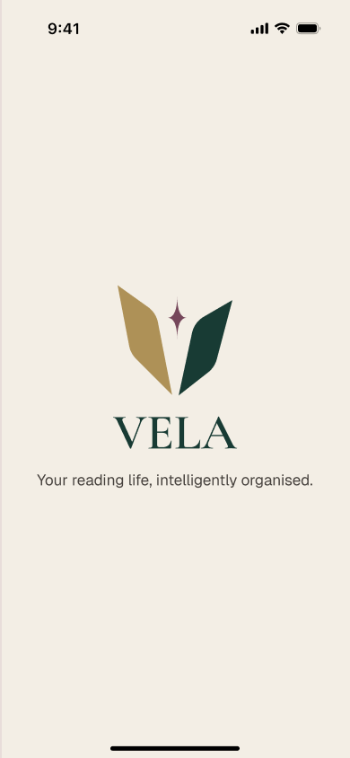<br /><strong>Splash</strong></td>
    <td align="center" width="50%">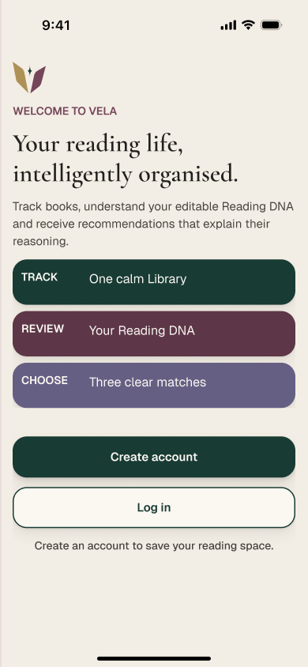<br /><strong>Welcome</strong></td>
  </tr>
  <tr>
    <td align="center" width="50%">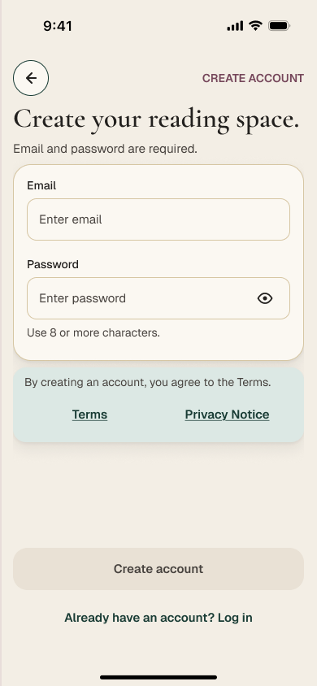<br /><strong>Sign up</strong></td>
    <td align="center" width="50%">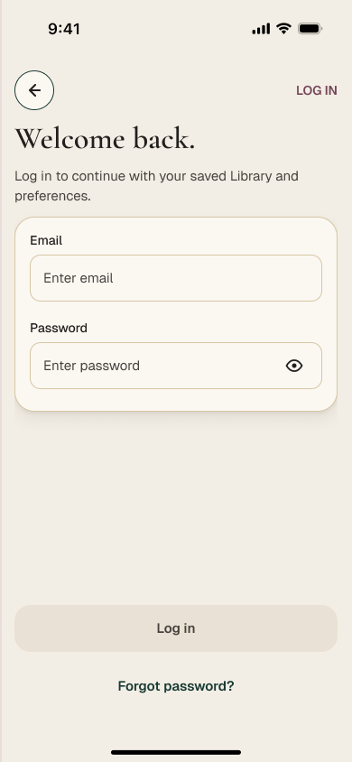<br /><strong>Log in</strong></td>
  </tr>
</table>

### Reading Setup and Permissions

<table>
  <tr>
    <td align="center" width="50%">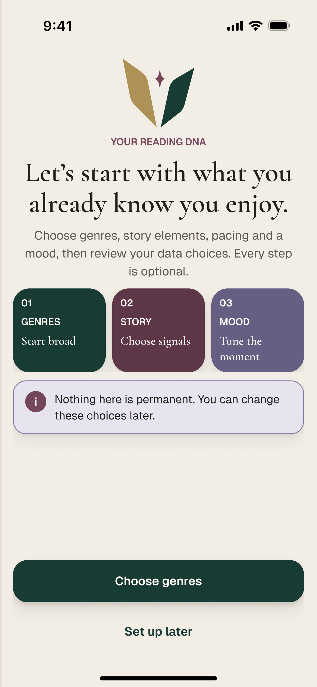<br /><strong>Reading setup</strong></td>
    <td align="center" width="50%">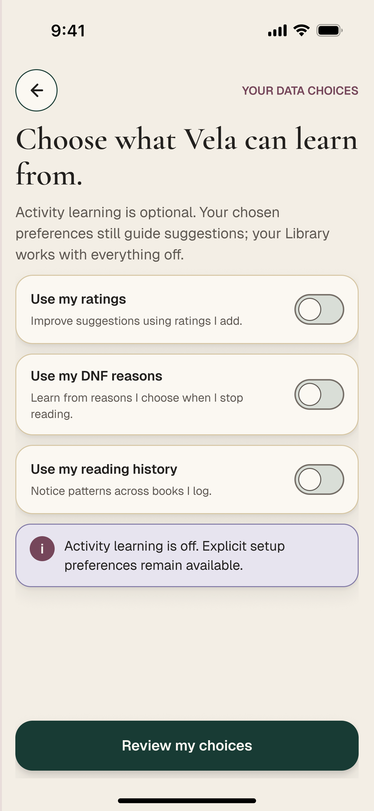<br /><strong>Learning permissions</strong></td>
  </tr>
</table>

### Home, Library and Add Book

<table>
  <tr>
    <td align="center" width="33%">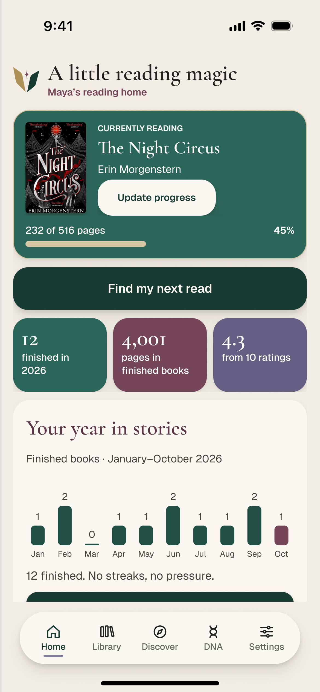<br /><strong>Home</strong></td>
    <td align="center" width="33%">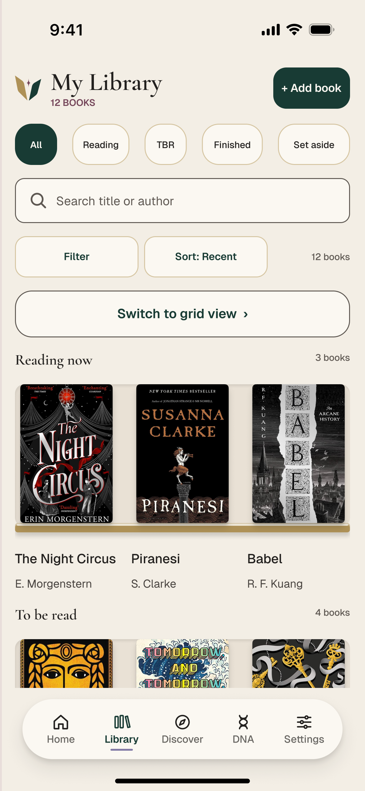<br /><strong>Library</strong></td>
    <td align="center" width="33%">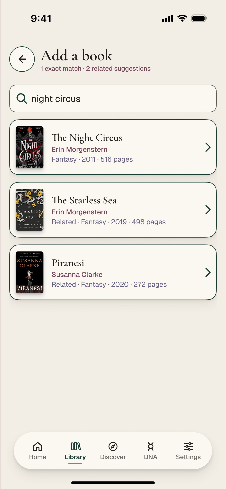<br /><strong>Add book</strong></td>
  </tr>
</table>

### Book Detail, Progress and Finish

<table>
  <tr>
    <td align="center" width="33%">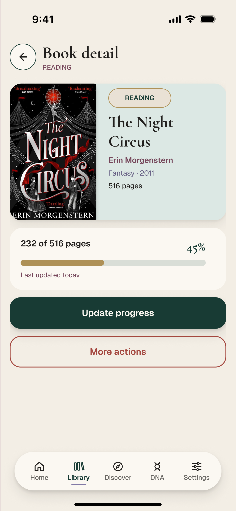<br /><strong>Book detail</strong></td>
    <td align="center" width="33%">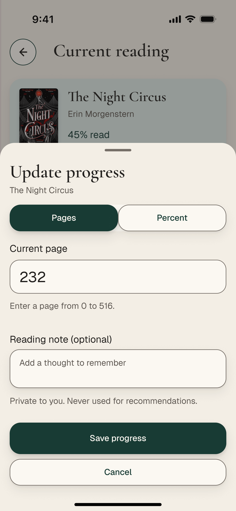<br /><strong>Update progress</strong></td>
    <td align="center" width="33%">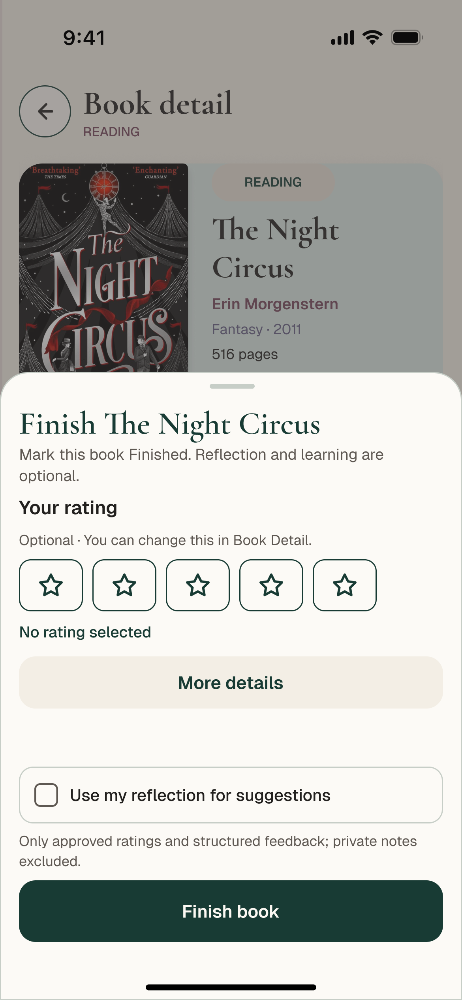<br /><strong>Finish book</strong></td>
  </tr>
</table>

### Set Aside, Discover and Recommendations

<table>
  <tr>
    <td align="center" width="33%">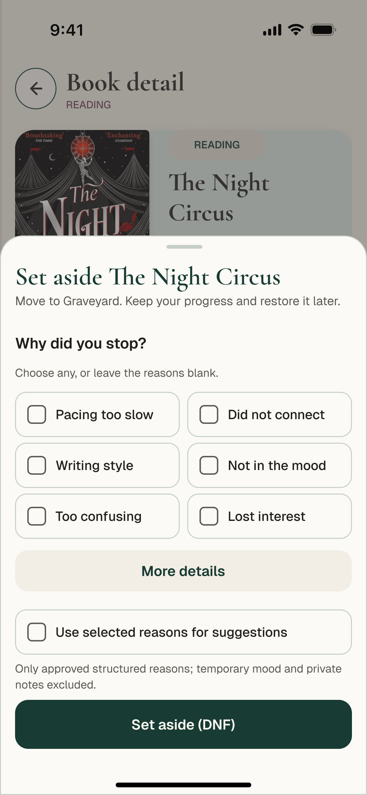<br /><strong>Set aside / DNF</strong></td>
    <td align="center" width="33%">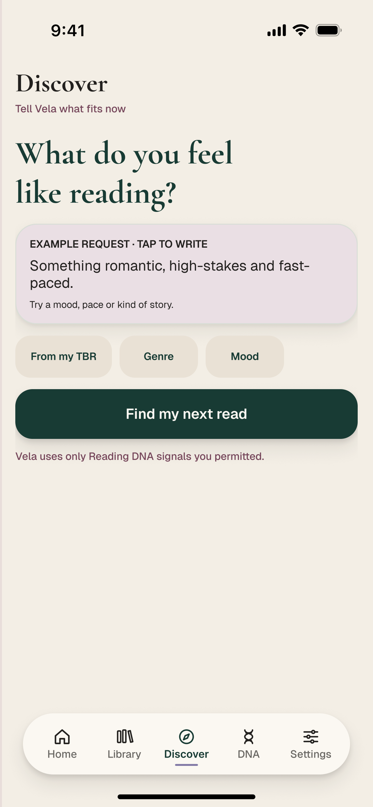<br /><strong>Discover</strong></td>
    <td align="center" width="33%">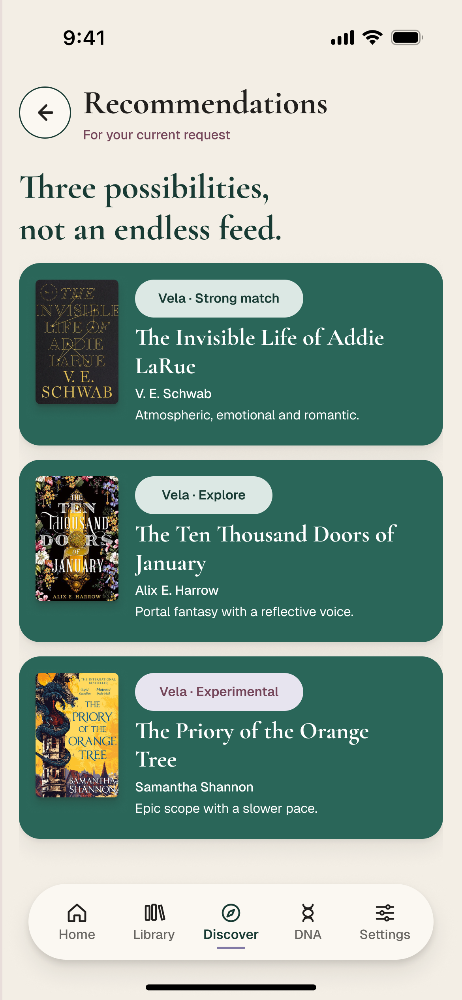<br /><strong>Recommendations</strong></td>
  </tr>
</table>

### Reading DNA, Stats and Settings

<table>
  <tr>
    <td align="center" width="33%">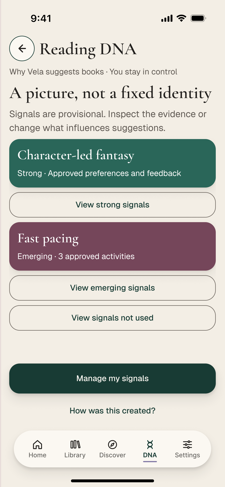<br /><strong>Reading DNA</strong></td>
    <td align="center" width="33%">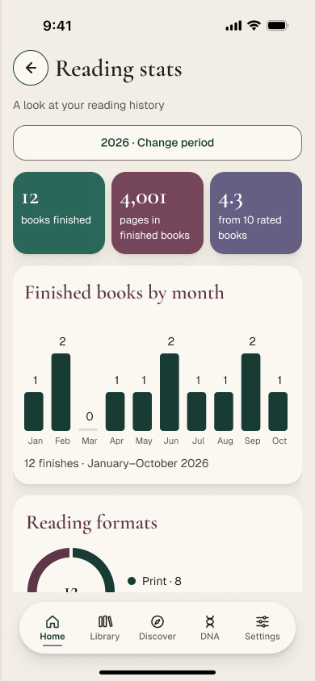<br /><strong>Reading stats</strong></td>
    <td align="center" width="33%">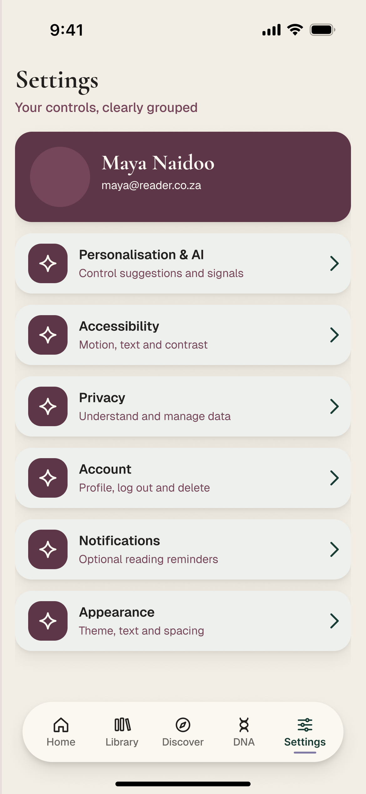<br /><strong>Settings</strong></td>
  </tr>
</table>

Frame names and node IDs are recorded in the [Figma export manifest](docs/images/figma/README.md). Separate [browser captures](docs/images/README.md) document the running implementation.

---

## Key Features

### Authentication

Email/password registration, confirmation, login, logout, password recovery/reset, persistent cookie-backed sessions and protected routes. Recoverable errors retain form input. Account entry requires only email and password.

### Reading Setup

Optional genre, story-element, pacing and mood choices; independent ratings/history/DNF permissions; editable review and a skip-personalisation path. Saved settings reload from Supabase, and unsaved drafts are reader-scoped.

### Library and Book Detail

Reading, TBR, Finished and Set aside shelves with search, filters, sorting, shelves/grid views and clickable real covers. Detail includes catalogue facts, description, progress, notes, favourites, dates and supported descriptive clues. Duplicate saves preserve existing history.

### Reading Progress, Finish and DNF

A shared modal opens from the relevant screens. Page/percentage validation, optional notes, start/end dates, whole-star ratings, structured reflection, DNF reasons, learning choices, retained retry and Undo are supported. Dirty edits prompt before dismissal.

### Discover and Recommendations

Current requests and filters guide catalogue retrieval. Three distinct verified works are saved atomically when suitable matches exist. Explanations separate facts from permitted preferences; service errors and insufficient matches have explicit recovery paths.

### Reading DNA

Review strong/emerging/not-used signals and their evidence. Keep, Reduce, Stop and Undo change the intended signal. Reset preserves the Library, explicit setup and privacy choices, and excludes old inferred activity through a cutoff.

### Reading Statistics

Year/all-time reading activity, genres, moods, pace, edition length and ratings link back to the relevant reading records. Missing facts remain unrecorded; unrated books do not inflate rating denominators.

### Settings, Account and Data

Theme, spacing, text size, reduced motion, contrast and optional reminder preferences persist. Readers can edit profile details, change email through verification, export private JSON, reset DNA and perform guarded account deletion.

### CSV Import

Preview Goodreads/StoryGraph-style files, validate rows and import safely without overwriting saved progress/notes. Both new and older imported books can resolve missing verified covers without re-importing.

Further behaviour and historical verification are documented in [Features](docs/FEATURES.md).

---

## User Flow

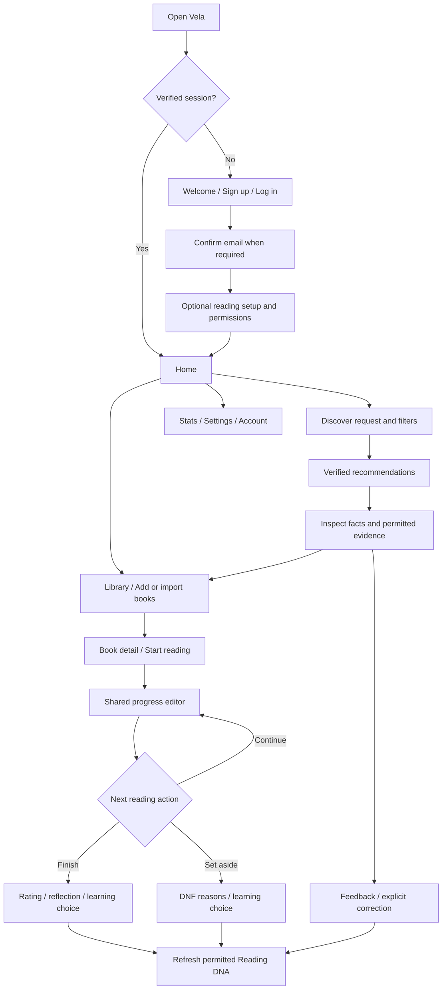

The diagram summarizes the main journey. Actual callbacks, unavailable states, retry/Undo and permission checks are described in the [technical guide](docs/TECHNICAL.md) and [API reference](docs/API.md).

---

<a id="packages"></a>

## Technology Stack

### Application

| Technology | Version | Purpose |
| --- | --- | --- |
| `next` | 16.4.2 | App Router, server rendering, Proxy and Route Handlers |
| `react`, `react-dom` | 19.3.0 | Interactive screens and reusable components |
| JavaScript | — | Application and domain logic |
| CSS / CSS Modules | — | Component styles and shared design tokens |
| `zod` | 4.6.5 | Inputs, restored state and generated-output validation |
| `lucide-react` | 1.47.0 | Icons alongside local Figma SVG assets |

### Backend and Services

| Technology | Version / role | Purpose |
| --- | --- | --- |
| `@supabase/ssr` | 0.12.7 | Cookie-aware browser/server clients |
| `@supabase/supabase-js` | 2.116.0 | Auth, database access and RPCs |
| Supabase PostgreSQL | Managed database | Reader-private tables, RLS, triggers and atomic operations |
| Google Books | External catalogue | Search, canonical metadata and covers |
| Gemini | External model | Structured recommendation and book-clue interpretation |
| Open Library | ISBN fallback | Verified public title/author matching for cover recovery |

### Development

| Technology | Version / role | Purpose |
| --- | --- | --- |
| Node.js / npm | Node >=20.19.0 | Runtime, scripts and locked installation |
| `@electric-sql/pglite` | 0.5.8 | Local PostgreSQL migration/privacy tests |
| `eslint` | 9.39.5 | Code checks |
| `eslint-config-next` | 16.4.2 | Framework lint rules |
| `supabase` | 2.117.0 | Database tooling |
| Git / GitHub | Version control | Repository and milestone tags |
| Figma | Design | Final UI and interactive prototype |

Forms use controlled native inputs and reusable semantic controls. React Hook Form and its resolver package were removed as unused dependencies. Exact versions are pinned in `package.json` and `package-lock.json`.

---

## Application Architecture

Vela uses one Next.js application with Supabase as its backend service. Interactive React screens call authenticated Route Handlers; server layouts and Proxy also verify sessions. There is no separate Express service.

<p align="center">
  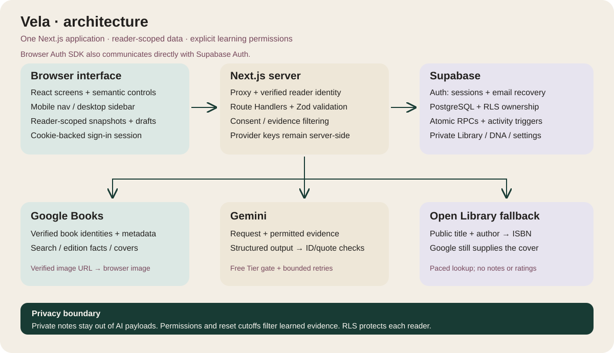
</p>

The server validates inputs, derives the reader from the session and loads data through reader-scoped clients. PostgreSQL enforces ownership with RLS and atomic operations. Provider keys remain server-side. Browser recovery state is scoped to the reader and cleared on sign-out/reader changes.

See [Technical Architecture](docs/TECHNICAL.md) for the folder map, state/concurrency behaviour, authentication and provider payload boundaries.

---

## Supabase Data Model

The final migrated schema has **11 application tables**, plus Supabase-managed Auth tables.

| Table | Responsibility |
| --- | --- |
| `profiles` | Display name, setup choices, preferences and reset cutoff |
| `books` | Shared catalogue facts and creator-private manual metadata |
| `user_books` | Reader shelves, progress, dates, ratings, notes and learning flags |
| `ai_settings` | Personalisation and independent data permissions |
| `reading_dna_signals` | Traits, permitted evidence and influence state |
| `recommendation_sessions` | Requests, filters and allowed context snapshots |
| `recommendations` | Verified book results, rank, reason and provisional labels |
| `recommendation_feedback` | Feedback, future preferences and explicit corrections |
| `reader_book_stats` | Optional reading-format/genre/mood/pace facts |
| `reading_dna_changes` | Versioned signal changes and Undo |
| `reader_book_updates` | Idempotent reading operations, before-state and Undo |

Private data belongs to the authenticated reader; request-supplied owner IDs do not grant access. Shared catalogue facts are intentionally available to authenticated readers, while manual metadata remains creator-private. New-reader optional learning permissions default off after all migrations.

The [Data Model](docs/DATA_MODEL.md) includes relationships, constraints, RPCs, consent, reset and deletion behaviour.

---

## CRUD Operations

| Area | Create | Read | Update | Remove / delete |
| --- | --- | --- | --- | --- |
| Library | Catalogue/manual/CSV additions | Shelves and book detail | Status, progress, dates, notes, ratings and favourites | Soft removal with Undo |
| Reading activity | Progress/finish/DNF operations | Saved records and stats | Reflection and descriptive facts | Guarded Undo of an operation |
| Recommendations | Atomic saved session/results | Results and explanations | Feedback/future preference/correction | Undo supported future preferences |
| Reading DNA | Setup and permitted activity signals | Groups and evidence | Keep, Reduce or Stop | Preference-preserving reset |
| Account | Supabase registration/profile | Own settings/export | Profile, verified email and preferences | Fresh-password verification and typed confirmation |

Account deletion removes the intended private account data; shared public catalogue metadata remains. A soft-removed Library book is not a permanently deleted account record.

---

## Recommendations and Reading DNA

Vela's recommendation flow combines the reader's current request with only the stored evidence they permit.

1. Validate the request and filters.
2. Load permitted preferences/activity and explicit corrections.
3. Ask Gemini for a bounded search plan and public book leads.
4. Retrieve and verify Google Books candidates; deduplicate works and editions.
5. Validate suggested book/signal IDs and supporting quotes against supplied facts.
6. Save the complete three-result session atomically, or return an honest recovery state.

Book facts, personal evidence and interpretation are presented separately. Strong/Explore/Experimental presentation is not a measured accuracy percentage. Metadata gaps remain uncertainty; the application must not invent plot facts to fill them.

Finishing/rating and approved structured activity can refresh DNA automatically. Global permissions, per-book learning choices, stopped/reduced traits and reset cutoffs still apply. Private notes are excluded from assembled AI payloads. Readers should avoid voluntarily typing sensitive information into search/request text.

The Gemini deployment gate defaults closed until billing is independently verified. Bounded retries and process-local cooldowns provide recovery; they are not an account-wide spending cap.

---

## CSV Import and Book Covers

Import supports UTF-8 Goodreads/StoryGraph-style CSV files or the supplied [Vela template](public/library-import-template.csv), up to **2 MB** and **2,000 rows**. Title and Author/Authors are required; supported optional fields include ISBN, shelf, rating, pages, dates, notes and favourites.

The file is previewed in browser memory, then normalized rows are sent in small JSON batches. Individual rows are atomic and retryable. Existing books are skipped without overwriting history; unmatched books become private manual entries. Import does not enable AI permissions.

Actual Google Books covers are used when verified. ISBN-10/13 equivalence and exact work matching improve recovery. Missing covers for older imports can resolve lazily through a reader-protected endpoint, including a paced Open Library ISBN fallback. The reading record is not replaced, and genuinely unavailable covers keep a placeholder.

---

## Responsive Interface and Accessibility

### Mobile and Desktop

Phones use bottom navigation and touch-friendly sheets. Desktop has persistent side navigation and layouts that use the available width. Tablet, narrow-screen and short-height states adapt without stretching a phone screenshot.

### Reading Comfort

Saved preferences include system/light/dark themes, comfortable/compact spacing, larger text, reduced motion and higher contrast. These settings are applied through the shared reader preference runtime.

### Semantic Interaction

Reusable controls use native inputs, labels, fieldsets and meaningful button/link roles. Focus visibility, validation messages, pending states, dialog focus management and dirty-edit confirmation support keyboard and assistive interaction.

### Verification Limits

Viewport checks support responsive testing but do not replace physical-device, accessibility or independent usability evaluation. See [Responsive Verification](docs/responsive-verification.md).

---

## Design System

### Core Palette

| Token | Colour | Role |
| --- | --- | --- |
| Parchment | `#F3EEE5` | Main canvas |
| Paper | `#FCFAF6` | Cards and controls |
| Ink | `#22201E` | Primary text |
| Evergreen | `#183B34` | Brand and primary actions |
| Plum | `#75465A` | Supporting emphasis |
| Mauve | `#827AA6` | Secondary accents |
| Brass | `#AE9157` | Book-like detail and highlights |

### Typography

**Cormorant Garamond** gives headings an editorial reading character. **Geist** supports body text, labels and controls. Font files and their SIL Open Font License texts are bundled locally.

### Visual Principles

- Book-inspired surfaces, cover imagery and shelf details.
- Clear separation between facts, interpretation and actions.
- Consistent rounded controls, spacing tokens and restrained depth.
- Semantic theme colours rather than fixed light-only surfaces.
- Native browser/device behaviour instead of drawn keyboards or status bars.

Shared tokens live in `src/styles/tokens.css`; component styles use CSS Modules.

---

## Project Structure

```text
vela/
├── src/
│   ├── app/
│   │   ├── (auth)/           # Entry, authentication and legal pages
│   │   ├── (setup)/          # Optional reading setup
│   │   ├── (app)/            # Protected product screens
│   │   ├── api/              # Authenticated Route Handlers
│   │   └── auth/             # Email/code callback handlers
│   ├── components/           # Shared controls and feature screens
│   ├── lib/                  # Validation, domain logic and server adapters
│   ├── styles/               # Tokens, base styles and licensed fonts
│   └── proxy.js              # Session verification and route protection
├── public/                   # Local logo/artwork and CSV template
├── supabase/
│   ├── migrations/           # Ordered schema, policies and RPC changes
│   └── tests/                # Manual hosted RLS boundary check
├── tests/                    # Node and PGlite regression suites
├── docs/
│   ├── images/figma/         # Original cover and final UI exports
│   ├── evidence/             # Dated sanitized verification
│   └── *.md                  # Technical guides and project records
├── .env.example              # Empty configuration template
├── package.json
└── package-lock.json
```

---

## Prerequisites

- Node.js **20.19 or later** and npm.
- Git and an editor.
- An active Supabase project with email/password authentication.
- Google Books/Gemini server credentials for provider-dependent features.
- Independent verification of the intended Gemini project's Free Tier/no-paid-billing configuration before enabling requests.

Existing Library tracking and manual entry do not require successful AI generation. Durable saves and authentication still require a reachable Supabase project.

---

<a id="environment-variables"></a>

## Environment Configuration

Copy `.env.example` to `.env.local` in the repository root.

| Variable | Visibility | Required / default |
| --- | --- | --- |
| `NEXT_PUBLIC_SUPABASE_URL` | Browser | Required project URL |
| `NEXT_PUBLIC_SUPABASE_PUBLISHABLE_KEY` | Browser | Required publishable key; never service-role |
| `GOOGLE_BOOKS_API_KEY` | Server | Catalogue search/lookup |
| `GEMINI_API_KEY` | Server | AI generation and insights |
| `GEMINI_FREE_TIER_VERIFIED` | Server | Defaults false; true only after independent billing verification |
| `GEMINI_ENABLED` | Server | Defaults true; false pauses Gemini calls |
| `GEMINI_MODEL` | Server | Optional; default `gemini-3.5-flash-lite` |
| `GEMINI_FALLBACK_MODEL` | Server | Optional; default `gemini-3.1-flash-lite` |

Only the two listed model IDs pass the code's allowlist; availability/quota is still provider-dependent. The verification flag does not change billing or impose a spending cap.

Only `.env.example` is tracked. Do not commit real keys, `.env.local`, test-account credentials or callback tokens. Provider keys must never use a `NEXT_PUBLIC_` prefix. Public configuration is embedded at build time: rebuild after changing the public Supabase settings and restart after changing server settings. Next.js manages `NODE_ENV`.

SMTP, Site URL and allowed redirects are configured in the Supabase dashboard, not additional app variables.

---

## Installation

### 1. Clone the Repository

```bash
git clone https://github.com/AngievR05/vela.git
cd vela
```

### 2. Install Dependencies

```bash
npm ci
```

Use the checked-in lockfile for a reproducible installation.

### 3. Configure the Environment

PowerShell:

```powershell
Copy-Item .env.example .env.local
```

macOS/Linux:

```bash
cp .env.example .env.local
```

Populate the settings described above; keep real credentials out of version control.

### 4. Configure Supabase

Apply the missing migrations in order and configure authentication callbacks/email as described in [Supabase Setup](#supabase-setup).

### 5. Check the Project

```bash
npm test
npm run lint
npm run build
```

---

## Running Vela

### Development

```bash
npm run dev
```

Open [http://localhost:3000](http://localhost:3000).

### Another Device on the Same Network

```bash
npm run dev -- --hostname 0.0.0.0
```

Use the computer's current LAN IP, allow the local port through its firewall, and update `allowedDevOrigins` in `next.config.mjs` plus the Supabase callback allowlist. The checked-in development hostname is `192.168.3.7`; change it when the network changes. Each origin/device has its own login session and cache. Production uses HTTPS.

### Production Build Locally

```bash
npm run build
npm run start
```

This starts the Next.js application server; it does not deploy a public site or apply database migrations.

---

## How to Use Vela

### First Launch

Create an account, confirm the email when required, and sign in. Complete optional reading setup or continue without personalisation. Each learning source remains a separate choice.

### Build a Library

Search a title, author or ISBN; inspect the result and save it. Use manual entry when the catalogue is unavailable, or preview/import an existing CSV Library. Select any book cover to open its details.

### Track Reading

Start a book and open Update progress from Home, Current Reading or Book Detail. Record pages or percent, save optional notes and review the saved result. Mark Finished explicitly when done.

### Reflect or Set Aside

Add an optional rating/reflection or DNF reason, confirm dates and choose whether eligible structured activity may be used for learning. Private notes remain separate.

### Find the Next Read

Open Discover, describe the current request and adjust filters. Inspect the recommendations and their evidence before saving. Use feedback and explicit signal controls when the assumptions do not fit.

### Review Reading DNA and Stats

Inspect signal evidence, change influence or stop a signal. Review the records behind statistics. Reset DNA only when intended; it preserves Library/setup/permissions.

### Manage the Account

Use Settings for appearance, permissions, CSV import, export and account controls. Notifications require browser support, permission and an open app.

---

## Supabase Setup

1. Create or resume the intended Supabase project.
2. Copy its public URL/publishable key into the environment; do not use a service-role key in browser configuration.
3. Apply **all ten migrations in filename order** for a new project. Existing projects apply only missing migrations; do not rerun historical SQL blindly.
4. Enable email/password authentication and configure Site URL and the intended callback allowlist.
5. Configure custom SMTP before public signup/reset acceptance.
6. Verify the hosted schema and two-reader privacy separately from local SQL tests.

The complete migration list, email templates and callback behaviour are in [Supabase Setup and Verification](supabase/README.md). The [Data Model](docs/DATA_MODEL.md) explains ownership and atomic operations.

---

## APIs and Technical Documentation

The application has **24 API method contracts**, all requiring a verified reader session. Handlers validate bodies, load reader-scoped data and return endpoint-specific success/error responses. Signup/login/recovery use the Supabase Auth SDK and callback handlers, not a custom admin API.

| Guide | Contents |
| --- | --- |
| [Technical Architecture](docs/TECHNICAL.md) | Packages, source map, sessions, state and provider boundaries |
| [API Reference](docs/API.md) | Paths, methods, schemas, responses, concurrency and error recovery |
| [Data Model](docs/DATA_MODEL.md) | Tables, relationships, RLS, consent and lifecycle |
| [Feature Behaviour](docs/FEATURES.md) | Detailed screen/flow behaviour and historical evidence |
| [Testing](docs/TESTING.md) | Commands, coverage, hosted/manual checks and limits |
| [Deployment](docs/DEPLOYMENT.md) | Host setup, production auth/email, smoke tests and rollback |

---

## Testing and Verification

```bash
npm test
npm run lint
npm run build
```

The latest verification on **21 October 2026** passed:

- **78 tests**, with no failures.
- **122 baseline RLS assertions** inside the test suite.
- **142 full-schema privacy/reset/deletion assertions** inside the test suite.
- Lint and production build, with **36 generated pages**.

Assertion totals are not additional test cases. Tests use Node, PGlite, synthetic reader fixtures and simulated provider responses. They cover authentication rules, reading transitions, consent, imports/covers, recommendations, corrections, quotas and reader isolation. Existing module-type auto-detection warnings are non-failing.

Separate browser/hosted records document real signed-in flows, controlled email receipt, imported cover recovery, responsive layouts and isolated error/Undo states. The Figma images in this README are design references, not evidence that a feature passed a hosted test.

See [Testing](docs/TESTING.md), the [Bug and Testing Log](docs/BUG_AND_TEST_LOG.md), historical [release evidence](docs/evidence/release-cleanup-2026-10-21.json), [production route checks](docs/evidence/production-smoke-2026-10-21.json) and [production browser checks](docs/evidence/production-browser-2026-10-21.json). The tagged cleanup previously had 71 tests; four loading-recovery tests and three stale-update regression tests bring the current total to 78. The hosted browser report separates core functionality from catalogue service availability.

---

## Deployment and Version Milestones

Vela requires a Node-capable Next.js deployment such as Vercel or a self-hosted Node server. Cookies, Proxy, Route Handlers and database access mean it cannot run as a static export. Configure production secrets, migrations, HTTPS origin, callbacks and SMTP before hosted acceptance.

| Tag | Milestone |
| --- | --- |
| `v0.8-feature-complete` | Historical core feature snapshot |
| `v0.9-validated-beta` | Responsive/theme recovery and CSV covers |
| `v1.0-mvp` | Tested final cleanup and package version 1.0.0 |

Tags identify committed code, not deployments. The README/documentation can advance after the tagged implementation; existing tags are not moved. The current [production app](https://vela-sepia-nine.vercel.app) runs on Vercel Hobby; its hosted checks and limitations are recorded in the deployment runbook.

Follow the [Deployment Runbook](docs/DEPLOYMENT.md) and [Release Milestones](docs/RELEASE_MILESTONES.md) for smoke tests, rollback and remaining acceptance work.

---

## Known Limitations

### Email Delivery

Controlled confirmation/reset email receipt was verified. Custom SMTP and delivery to a controlled non-project-team inbox on production URLs remain public-launch acceptance items.

### External Services

Google Books/Gemini may be unavailable, quota-limited or unable to supply enough suitable verified works. Drafts are retained and tracking/manual entry remain available. Missing facts/covers are not invented.

### Recommendation Interpretation

Fit labels are provisional. Thin metadata cannot prove absence of a trope, exact reading order or suitability. Generated confidence is not an objective accuracy metric.

### Notifications

Reminders depend on browser permission, support and an open app. There is no guaranteed background push or email scheduler.

### Offline and Hosted Privacy

Reader-scoped recovery supports already-loaded pages, not guaranteed cold offline launch. Durable saves need Supabase, and conflicts require review. Local SQL tests do not certify the currently deployed policies.

### Device and Accessibility Coverage

Viewport testing does not replace physical-device checks or an independent accessibility/usability evaluation. Current release risks and historical dependency findings are recorded separately in the [Risks Update](docs/RISKS_UPDATE.md).

---

## Future Improvements

Potential work beyond the current MVP, subject to a new scope decision:

1. Complete public SMTP and production-domain acceptance.
2. Expand documented human recommendation-relevance evaluation and exclusion checking.
3. Broaden physical-device, assistive-technology and independent usability coverage.
4. Evaluate background reminders and offline launch support as explicit new infrastructure work.
5. Revisit distributed quota/operational monitoring before larger-scale deployment.

These are not silently enabled features or new deadline commitments.

---

## Project Information

**Project:** Vela<br />
**Repository:** https://github.com/AngievR05/vela<br />
**Tagline:** Your reading life, intelligently organised.<br />
**Version:** 1.0.0 MVP<br />
**Platform:** Responsive web application for mobile and desktop<br />
**Primary Framework:** Next.js + React<br />
**Backend:** Supabase Auth + PostgreSQL/RLS<br />
**Book Data:** Google Books, with an Open Library ISBN fallback for cover recovery<br />
**AI Service:** Gemini<br />
**Design:** Figma final UI and interactive prototype

---

## Acknowledgements

Vela uses Next.js, React, Supabase, Zod, Lucide React, PGlite, Google Books, Gemini and Open Library. Cormorant Garamond and Geist support the reading-led typography. The supplied logo and Figma artwork establish the project's visual identity.

Book covers and catalogue content remain subject to their rights holders' terms. Third-party frameworks, libraries, services and font assets retain their respective licences.

---

## Licence

No standalone application `LICENSE` file is currently declared in this repository. Project-specific code/design assets are not assigned a new open-source licence by this README. Bundled font licence texts are included under `src/styles/fonts/`; third-party code and book artwork remain subject to their own terms.

---

## Project Statement

> **Vela connects the practical work of tracking books with a transparent, editable understanding of reading preferences. By combining a personal Library, deliberate reflection, permitted evidence and correctable recommendations, it keeps the reader involved in deciding what their next chapter should be.**

<p align="center">
  <strong>Vela — Your reading life, intelligently organised.</strong>
</p>
