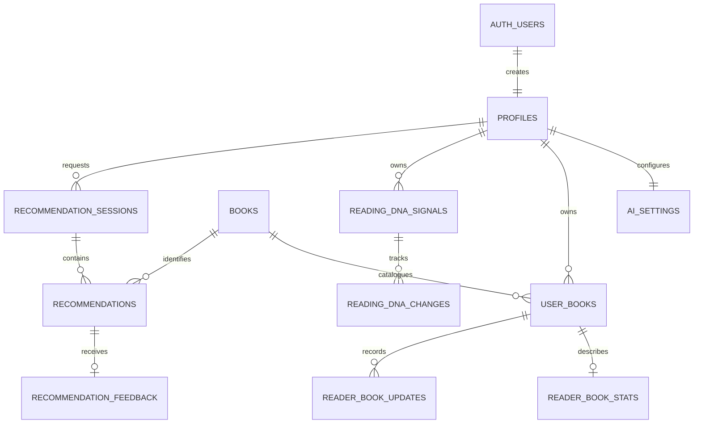

# Data model and privacy

MVP 1.0.0 · reviewed 21 October 2026. The authoritative schema is the complete ordered set of [SQL migrations](../supabase/migrations), not a generated copy of a hosted database. [API](API.md) · [architecture](TECHNICAL.md).

## Relationships

The diagram emphasizes primary relationships. Private tables also carry a reader foreign key; feedback can reference a corrected signal, and manually entered `books.created_by` references a profile. Signal evidence/matched signals are JSON references resolved and filtered by application/database logic, not direct relational foreign keys for every evidence item.

## Tables

| Table | Key / ownership | Main stored data |
| --- | --- | --- |
| `auth.users` | Supabase-managed Auth UUID | Identity, verified email and authentication metadata; not an application password table |
| `profiles` | `id` = Auth UUID | Display name, setup choices/completion, reader appearance/reminder preferences, DNA reset cutoff |
| `books` | UUID; unique `google_books_id`; nullable `created_by` | Title/authors, description, pages, genres, publication date, thumbnail and ISBN. Google metadata is shared among authenticated readers; manual metadata belongs to its creator |
| `user_books` | UUID; `user_id`; unique `(user_id, book_id)` | Shelf, exact page/percent progress, rating, private notes, favourites, soft removal, start/finish/stopped dates, structured reflection/DNF reasons and per-book learning flags/activity timestamps |
| `ai_settings` | `user_id` primary key | Global personalisation and independent ratings/history/DNF permissions |
| `reading_dna_signals` | UUID + `user_id`; unique reader/category/label | Structured trait, weight, source, evidence JSON, active state, influence state and timestamps |
| `recommendation_sessions` | UUID + `user_id` | Request, filters, permitted signal snapshot, candidate IDs, status and timestamps |
| `recommendations` | UUID + `user_id`; session/book references | Rank 1–3, reason, matched signal JSON and provisional confidence label |
| `recommendation_feedback` | UUID + `user_id`; unique recommendation | Helpful/not-for-me, reason, future preference and optional signal correction reference/action |
| `reader_book_stats` | `id` = Library row UUID; `user_id` | Optional format, primary genre, mood/pace facts and metadata timestamps |
| `reading_dna_changes` | Operation UUID + `user_id` | Signal, action, previous influence state, expected/applied version and Undo state |
| `reader_book_updates` | Operation UUID + `user_id`; Library row | Reading request, before-state, resulting version/result and Undo state |

There are **11 application tables in `public`**, plus Supabase-managed Auth tables. Reader appearance is JSON in `profiles`; there is no separate notification-delivery table, CSV-file upload table or object-storage bucket configured by this repository.

## States and constraints

- Library status is `want_to_read`, `reading`, `finished` or `dnf`. UI labels include TBR and Set aside/Graveyard. A removed book is hidden through `is_removed`, not a fifth shelf.
- Percent progress is 0–100; exact current pages are separately recorded when known. Ratings are nullable whole stars 1–5. Unknown metadata is null/empty rather than inferred certainty.
- Finish/DNF operations validate calendar dates, ordering and structured enum choices. Progress at 100% does not itself set Finished.
- A reader has one saved row per catalogue book. Different Google volume IDs may represent editions of the same work; import/recommendation logic performs additional ISBN/work matching.
- Recommendation rows are unique per session/rank and session/book. The save RPC validates the complete three-result session atomically; the relationship diagram's generic cardinality does not weaken that contract.
- Composite owner foreign keys prevent attaching recommendations/feedback/corrections to another reader's parent row. Application checks complement RLS rather than replacing it.
- Timestamps and explicit operation IDs support conflict detection and idempotency. Reuse a mutation UUID only for retries of the same operation.

## RLS and roles

The MVP has one end-user role: the authenticated reader. Supabase's `anon`/`authenticated` database roles and managed service roles are infrastructure roles, not additional reader/admin screens. There is no application librarian/moderator/admin dashboard.

Private rows are scoped using `auth.uid()` in policies and operations. The API derives identity through verified Auth; it does not authorize from a request's `user_id`. No anonymous private table reads or RPC execution are intended. Shared public catalogue facts are intentionally readable by authenticated readers; manually entered metadata is creator-private and cannot be attached by another reader.

Most app write RPCs execute as `security invoker`, preserving reader RLS. Deliberate elevated functions include the Auth profile-creation trigger and guarded account deletion; these have constrained search paths and ownership/verification checks. Do not change an invoker function into a definer as a workaround for a permission failure.

New-reader optional learning sources default off after the setup migration, even though the earliest base schema had different defaults. Always inspect the final migrated schema, not only the initial migration.

## Atomic operations

| Operation | Purpose |
| --- | --- |
| `save_reading_setup` | Save tastes/permissions and onboarding signals together |
| `add_manual_book` | Retry-safe creator-private metadata and Library addition |
| `save_recommendation_session` | Save verified public candidates and all three reader recommendations together |
| `record_recommendation_feedback` | Persist feedback/future preference or an explicit permitted correction |
| `save_reader_settings` | Validate profile/preferences/permissions writes |
| `import_library_row` | Add one normalized row without overwriting an existing saved book |
| `save_reading_record` | Save finished-book facts/date with version checks |
| `change_reading_dna`, `reset_reading_dna` | Idempotent influence changes, Undo and preference-preserving reset |
| `save_reader_update` | Progress/finish/DNF/date/restore/Undo state transitions and saved results |
| `refresh_reading_activity` and triggers | Rebuild currently permitted activity evidence after relevant changes |
| `delete_reader_account` | Verify target/recent password confirmation and remove intended account data |

Use the application API/domain helpers instead of manually bypassing these invariants from a new screen.

## Consent, reset and deletion

Global personalisation is separate from ratings, history and DNF sources. Per-book rating/history/reflection/DNF choices further limit what can be used. Learning can be declined without blocking tracking. Structured activity may refresh DNA automatically only when current permissions and reset cutoffs permit it. Private notes are excluded from generated recommendation/insight payloads.

Strong signal presentation requires sufficient distinct permitted evidence, not a generated confidence percentage. A stopped signal remains excluded; a reduction changes influence. Ordinary Helpful/rejection does not silently rewrite a structured trait.

DNA reset clears inferred evidence/corrections and records a cutoff. Library, ratings, notes, progress, setup choices and permissions remain. Old activity must not silently reappear after reset. This operation is distinct from deleting the account.

Account deletion first removes the reader's dependent recommendation/Library references, creator-private manual metadata and Auth account; profile-owned private data cascades. Shared Google Books catalogue metadata remains. Soft Library removal instead retains data for Undo. Export is reader-private JSON containing available owned records and referenced book facts, not secrets/passwords.

## Migrations and verification

The [Supabase guide](../supabase/README.md#migration-order) lists all ten migrations. New installations apply them in filename order. Existing installations apply only missing migrations and record execution; migrations already applied must not be edited and rerun as an upgrade strategy. Take an appropriate database backup before a production schema change.

`npm test` executes the checked-in SQL in PGlite with emulated Auth roles/claims. It tests ownership, anonymous denial, spoofed parents, writes/Undo, consent, reset and deletion. The final cleanup run passed 122 baseline RLS and 142 full-schema privacy assertions inside the 71-test suite. These results do not establish that a hosted project's actual grants/policies are up to date. See [testing](TESTING.md) and the existing [manual RLS check](../supabase/tests/rls_boundary_manual.sql).
