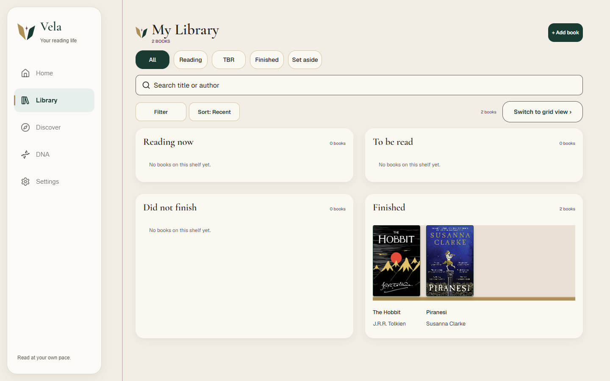
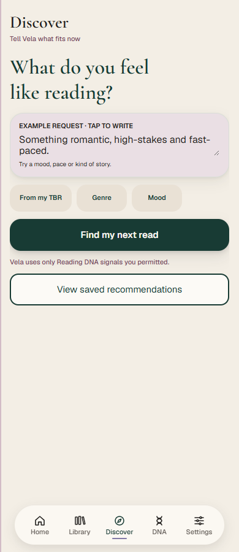

# Deployment runbook

MVP 1.0.0 · deployed 21 October 2026 to [Vela production](https://vela-sepia-nine.vercel.app) on Vercel Hobby. [Hosted verification](evidence/production-smoke-2026-10-21.json) · [browser verification](evidence/production-browser-2026-10-21.json) · [Setup/environment variables](../README.md#environment-variables) · [testing](TESTING.md) · [release limits](RELEASE_MILESTONES.md).

## Current production configuration

The expanded [production QA review](PRODUCTION_QA_2026-10-21.md) subsequently exercised controlled disposable-reader writes, confirmed reset-email receipt, and deployed the stale-update conflict fix. Its final reading recheck passed; current automated coverage is 78 passing tests. These results supplement the initial read-only deployment evidence below.

- Project: `241077-6607/vela`; Next.js framework, Node 24, `npm ci`, `npm run build`, default Next.js output. The checked-in `vercel.json` makes framework/build detection explicit.
- Production has all eight documented app variables. Provider keys are Vercel secrets; only the Supabase URL and publishable key are browser configuration. Existing keys use the owner's previously verified free-tier project; no paid plan, AI Gateway or paid billing fallback was enabled.
- `.vercelignore` excludes local environment files, disposable-account credentials, temporary evidence, tests and documentation from source uploads. `.vercel/` stays out of Git.
- The owner confirmed setting Supabase Site URL to the production origin and adding `https://vela-sepia-nine.vercel.app/auth/callback**`, while preserving local callbacks. This is owner-confirmed configuration; production confirmation/reset inbox delivery still needs separate acceptance. Custom SMTP and arbitrary public email delivery remain outstanding.
- Public routes, private-route redirects, API denial, login/reload/logout and mobile/desktop authenticated pages were exercised on the deployed app. These checks did not change Library records or settings. Provider availability and untested write/email flows are recorded separately in the evidence; a deployment is not a claim that every external service is always available.
- Google Books initially returned an upstream 503, then recovered on a bounded hosted retry (three results). A deployed Gemini book-clue request succeeded. The production-only dependency audit reported zero vulnerabilities; hosted installation also reported development-tool advisories. [Deployment record](evidence/production-deployment-2026-10-21.json) · [provider checks](evidence/production-providers-2026-10-21.json) · [browser configuration/secret scan](evidence/production-client-config-2026-10-21.json).

Actual production screenshots from the controlled disposable account:





Repeat the read-only public checks with:

```bash
node scripts/smoke-production.mjs https://vela-sepia-nine.vercel.app
```

This release was deployed from the local workspace using Vercel CLI, including the approved UI fixes. Git-triggered automatic deployments have not been connected. For later releases, deploy from the intended clean revision using `npx vercel deploy --prod`; verify the alias and hosted behaviour again. Do not move the existing milestone tags.

## Deployment shape

Vela needs a Node-capable Next.js server with cookie sessions, Proxy, Route Handlers and outbound access to Supabase and optional book/AI services. A static-only host/export cannot run the implemented application. Install from the checked-in lockfile and select a Node version satisfying `package.json` (`>=20.19.0`).

The configuration contains no required Docker service, background worker, scheduled job or storage bucket. Supabase remains an external database/Auth service. The code sets long-running route hints, but actual execution limits and billing are determined by the host's configuration/plan.

## Vercel deployment

1. Import the repository as a Next.js project, with the repository root as root directory.
2. Use the lockfile installation (`npm ci`) and build (`npm run build`). Let the Next.js framework integration manage the output; do not configure a static `out` folder.
3. Configure the eight documented environment variables for the intended Production/Preview environments. Keep provider credentials server-only. Use a separate controlled Supabase project for previews where possible; never treat a preview as disposable if it points to real reader data.
4. Apply missing database migrations once, in order. Builds do not apply migrations automatically.
5. Configure the intended HTTPS domain and Supabase authentication/email settings below. Rebuild after changing `NEXT_PUBLIC_` values.
6. Deploy the chosen commit/tag, inspect build/function logs without printing secrets, and run the smoke tests below.

Vercel's official [Next.js integration guide](https://vercel.com/docs/frameworks/full-stack/nextjs) describes the framework deployment. Hosting-plan eligibility, limits and costs must be checked for the actual account; the repository does not establish a free production hosting entitlement.

## Node self-hosting

With the environment populated and migrations applied:

```bash
npm ci
npm test
npm run lint
npm run build
npm run start -- --hostname 127.0.0.1 --port 3000
```

Use a process supervisor and an HTTPS reverse proxy appropriate to the host. Forward the real request host/scheme correctly because callback URLs are built from the request origin. Keep environment files outside source control and restrict access to logs/configuration. The installed framework's detailed guidance is at `node_modules/next/dist/docs/01-app/02-guides/self-hosting.md`.

## Authentication and email

The Supabase project must be online, email/password Auth enabled, and the complete migrated schema present. Follow [Supabase setup](../supabase/README.md) for the actual callback/template handling.

Set the **Site URL** to the real production HTTPS origin. Allow the callback destination used by Vela, including its validated `next` query. For example, using the documentation-only domain `https://vela.example.com`, allow the app's `/auth/callback` destination pattern needed for `/setup`, `/settings` and `/reset-password` returns. Use tightly scoped origins/paths and the minimum wildcard needed for callback queries; do not broadly allow arbitrary sites. The alternative `/auth/confirm` token-hash route must agree with the configured email template. Supabase's [redirect URL guide](https://supabase.com/docs/guides/auth/redirect-urls) explains Site URL and allowlist matching.

The built-in PKCE callback needs the initiating browser's verifier cookie. Use the same browser/origin for the test; cross-device email links may need the configured token-hash template approach. Do not paste real callback tokens into issues, screenshots, logs or docs.

Configure **custom SMTP in Supabase** using the owner's selected email provider, sender identity and provider-required domain verification. SMTP secrets belong there, not in Vela's `.env.example`. The current acceptance record verifies controlled inbox receipt, not arbitrary public signup/reset. Supabase's default mail service has recipient/rate restrictions; see its [SMTP guide](https://supabase.com/docs/guides/auth/auth-smtp).

Accept public email setup only when a controlled **non-project-team inbox** receives signup confirmation and reset mail on the intended production URLs, confirmation activates the account, reset completes and a subsequent login succeeds. Preserve the original owner's credentials; use disposable accounts for this cycle.

## Provider configuration

- Add Google Books and Gemini server keys to the host's secret environment. Do not rename them with `NEXT_PUBLIC_` or embed them in screenshots.
- Leave `GEMINI_FREE_TIER_VERIFIED=false` until the owner independently verifies Free Tier with no paid billing attached. The local owner's previous confirmation does not verify a new production key/project.
- `GEMINI_ENABLED=false` is an emergency pause. The model/fallback IDs must pass the code allowlist. Setting flags does not create or enforce a billing cap.
- Confirm the host supports the advertised route durations: recommendations and CSV batches request 180 seconds; cover resolution requests 90 seconds. Actual hosting timeouts may be shorter. Test realistic imports and slow/outage paths rather than assuming the hint overrides host limits.
- Quota cooldowns and caches live in each process. Multiple instances do not share a global quota meter. Never enable paid usage as an invisible retry workaround.

## Production smoke test

1. Confirm public entry/legal screens render and private pages/APIs deny signed-out access.
2. Complete signup/confirmation, login/reload, logout and reset on a disposable controlled account.
3. Add a manual and catalogue book; verify duplicate preservation, real cover/detail identity and every shelf.
4. Save progress, finish/rate with dates, decline/allow learning, DNF/restore and Undo. Verify stale changes do not overwrite newer data.
5. Import a small disposable CSV; check preview, row results, duplicate preservation and cover recovery.
6. Generate recommendations for an explicit request, inspect actual book facts, save/Undo and feedback/correction. Disable personalisation and check excluded evidence stays excluded. Do not treat model confidence as measured accuracy.
7. Check theme, mobile/desktop navigation, large text, dialogs and retained input after a recoverable error.
8. Use two disposable reader sessions to check private isolation on the hosted schema. Test export and account deletion only on explicitly disposable data; reset must preserve Library/setup/permissions.
9. Verify expected provider timeout/quota recovery and core tracking during AI failure. Do not deliberately exhaust real quotas or disable shared production services for a smoke test.

Record date, deployment commit/origin, controlled account aliases, result and bug links in [the testing log](BUG_AND_TEST_LOG.md). Do not record passwords, access tokens or keys. An automated local pass is not a substitute for this hosted acceptance.

## Rollback and operations

Keep the previous deployment revision and its matching schema requirements. Roll back application code through the host or deploy an existing tag; do not force-move `v1.0-mvp`. Local tags are not automatically pushed or deployed. Database migrations are separate from application deployment: use a reviewed forward repair or a verified backup/restore procedure, not deletion of migration history.

Monitor Auth/database failures, provider quota/timeouts and import errors without logging sensitive payloads. If Gemini is unavailable or billing status changes, pause it through the existing switch and redeploy/restart as required. A Supabase pause also affects Auth and durable writes; an AI pause alone should leave tracking usable.

Closed-app notifications, guaranteed email scheduling and offline cold launch are not implemented deployment services. See [known acceptance limits](RELEASE_MILESTONES.md#known-acceptance-limits).
